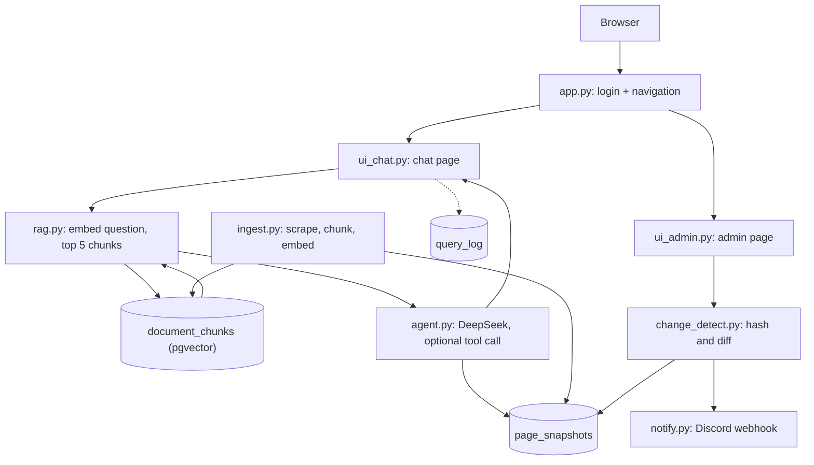
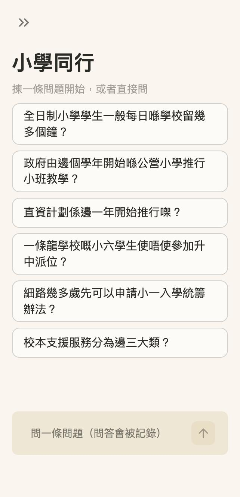
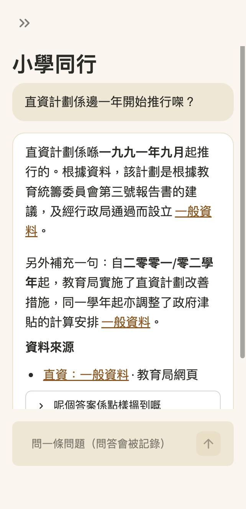
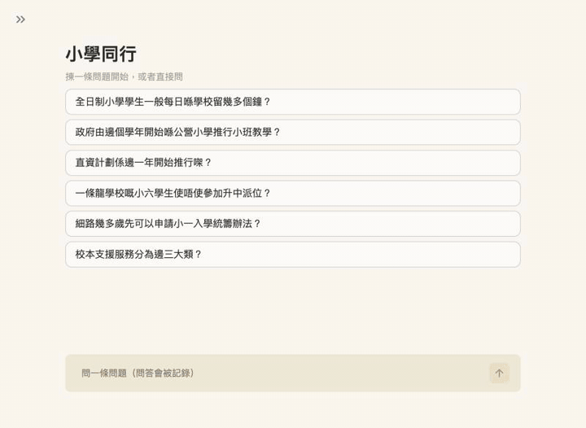
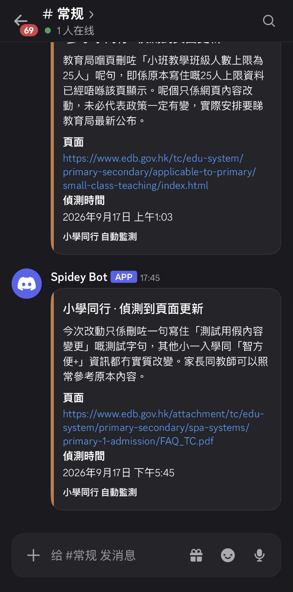

# 小學同行


A grounded Q&A agent over Hong Kong's EDB primary-education policy pages — ask it a question, it answers from indexed source pages with inline citations, and says "I don't know" instead of making something up when a page doesn't cover it.

## Contents

- [Overview](#overview)
- [Architecture](#architecture)
- [Demo](#demo)
- [Eval results](#eval-results)
- [Quick start](#quick-start)
- [Configuration](#configuration)
- [Usage](#usage)
- [Project structure](#project-structure)
- [Testing](#testing)
- [Deployment](#deployment)

## Overview

Parents and teachers looking up EDB policy — whole-day schooling, direct subsidy scheme, P1 admission — currently have to dig through a maze of HTML pages and PDFs on the EDB site. This app indexes that content once and lets you ask it directly, in Cantonese, with every answer traceable back to the page it came from.

Four things it does:

1. **Grounded Q&A** — retrieves relevant chunks from Supabase pgvector, feeds them to DeepSeek as context, and requires the model to cite `[Section Title](URL)` for anything it states. If nothing relevant is in the index, it says so rather than guessing.
2. **Agent tool calling** — the LLM can call `get_section_last_updated` to check when a section last changed, and the call is visible live in the sidebar, not hidden behind the scenes.
3. **Change detection** — hashes each tracked page's normalized text and diffs it against the last snapshot stored in Supabase.
4. **Push notifications** — when a page changes, DeepSeek summarizes the diff in plain Cantonese and posts it to a Discord webhook, so nobody has to read a raw HTML diff.

**Stack**: Streamlit for the UI, DeepSeek (`deepseek-flash`) for generation and tool calling, a local `sentence-transformers` model (`intfloat/multilingual-e5-small`) for embeddings, Supabase (Postgres + pgvector) for storage and retrieval, Discord webhooks for notifications.

This indexes a fixed set of 25 EDB pages plus one whitelisted PDF — not a general crawler — and runs behind a single admin login with no self-registration. Scope and auth choices like these are deliberate for a single-tenant demo, not gaps; see the technical note's scalability section for what changes past that.

## Architecture

Three pipelines share one Supabase project and a few helpers (the database client, the scraper, the embedding function). None of them depends on another's runtime state, so each can be run or changed on its own.



**Answering a question.** The question is embedded with `intfloat/multilingual-e5-small` and matched against `document_chunks` by cosine similarity in Postgres (`match_document_chunks`). The top 5 chunks are kept only if they score at least 0.85. That cutoff looks high, but e5 scores even unrelated pairs around 0.8, so a lower one lets everything through. What survives goes to DeepSeek as context, with a system prompt that requires a `[Section Title](URL)` citation for every claim and the fixed reply "資料庫中未有相關資訊" when the context doesn't cover the question. The model can also call `get_section_last_updated`, which looks up the page behind a section and returns when its snapshot last changed. Under each answer, a collapsed note lists the steps in plain language; the full trace (scores, tool calls) is on the admin page and in `logs/agent_trace.jsonl`.

**Ingesting pages.** `ingest.py` fetches the 25 pages and the PDF, and splits the text into chunks. A block of up to 800 characters stays whole; longer text is cut into 500-character windows with 150 characters of overlap. Each chunk is embedded with the `passage:` prefix e5 expects, and a URL's old chunks are deleted before its new ones are inserted, so re-running it never leaves duplicates. At the end it stores a baseline snapshot of every page, so change detection has something to compare against.

**Detecting changes.** `change_detect.py` fetches each page, normalises the text and compares its SHA-256 with the stored snapshot. A page with no snapshot yet just gets a baseline stored. Otherwise, a different hash makes DeepSeek summarise the diff in plain Cantonese (the first 4000 characters of it), the snapshot is replaced, and `notify.py` posts the summary to Discord. The pages are fetched one second apart, so a full check takes about half a minute.

**Logging.** After each answer, `query_log.py` writes the question, answer and ask time to Supabase on a background thread. It retries once and swallows every error, so a database problem can never slow down or break an answer.

**Why it's built this way.** The app runs entirely server-side with the Supabase `service_role` key; the tables have Row Level Security on and no policies, so the browser-facing `anon` key can't read anything. The page list is a constant in `config.py` rather than a table, because a fixed list of 26 sources doesn't need an admin UI. The embedding model is loaded once per process and warmed up in a background thread before the login gate, so the first real question doesn't pay the load time.

## Demo

 

The main page on a phone: suggested questions to start from, and an answer that names its sources. Below is a walkthrough recorded before the interface redesign, so the trace and refresh button it shows now live on the admin page.



Grounded Q&A (in-domain, out-of-domain, and an edge-case question), the tool-call trace, and a detected page change pushed to Discord — all in one recording.

The Discord notifications below come from the same demo. The page changes were staged by editing the stored snapshot, so the described diffs are test content, not real EDB edits.



## Eval results

50 hand-written questions run through the real retrieval and agent code (`scripts/eval.py`), 2026-09-30: 30 in-domain, 12 out-of-domain, 8 edge cases. Each in-domain question has an expected source page and a key fact the answer must contain, both checked by string match. The questions are mine, not an independent benchmark. I ran it twice and got the same three misses, but LLM output varies, so treat a point or two as noise.

| Measure | Result |
|---|---|
| Right source page retrieved, in-domain | 30/30 (100%, 95% CI 89-100%) |
| Chunk containing the key fact retrieved, in-domain | 29/30 (97%, 95% CI 83-99%) |
| Answer correct, in-domain | 29/30 (97%, 95% CI 83-99%) |
| Correct decline, out-of-domain | 12/12 (100%, 95% CI 76-100%) |
| Cited links matching the known source list | 50/50 (100%, 95% CI 93-100%) |
| Edge cases judged correct | 3/5 (the other 3 of 8 have no fixed answer and are scored on retrieval only) |

Page-level hit rate flatters retrieval, which is why the chunk-level row is there. All three misses are retrieval failures, not the model making things up; it declined because the fact wasn't in what it was given:

- 校本支援服務入面邊個組別負責中學校本課程發展？ The right page is retrieved, but not the chunk that names 中學校本課程發展組.
- 喺邊度可以攞到小一入學申請表？ Same pattern on the admission FAQ PDF: right document, wrong chunk in the top 5.
- "What is the Direct Subsidy Scheme in Hong Kong?" The right page ranks first, but at 0.79 similarity it falls under the 0.85 threshold, so nothing is passed to the model. English queries against a Chinese index need a lower threshold or a query-translation step.

Reproduce with `python scripts/eval.py` (needs `.env` and an ingested index; results go to `eval_results.json`, which is gitignored). Two questions ask for circular numbers from the 數字教育 news list, so they will go stale when EDB updates that page. Unit tests are separate and run in CI on every push.

## Quick start

**Requirements**: Python 3.11+, a Supabase project, a DeepSeek API key, a Discord webhook URL (optional, only needed for push notifications).

```bash
git clone <this repo>
cd EduPulse-HK
python3 -m venv venv
source venv/bin/activate
pip install -r requirements.txt
```

Copy `.env.example` to `.env` and fill in your keys (see [Configuration](#configuration) below), then create the Supabase schema:

```bash
psql "$SUPABASE_DB_URL" -f sql/supabase_schema.sql
# or paste sql/supabase_schema.sql into the Supabase SQL editor
```

Ingest the source pages, then run the app:

```bash
python ingest.py       # scrapes EDB pages + the whitelisted PDF, embeds and stores chunks
streamlit run app.py
```

Open the URL Streamlit prints. First load is slower than usual — the embedding model has to load into memory once. If you have Node installed, `npm run dev` runs the same `streamlit run app.py` (and `npm run test` runs the unit tests); it assumes the virtual environment is in `venv/`.

## Configuration

`.env`:

```
DEEPSEEK_API_KEY=       # https://platform.deepseek.com
SUPABASE_URL=           # your Supabase project URL
SUPABASE_KEY=           # service_role key — not anon, see note below
SUPABASE_PROJECT_ID=    # Supabase project ref
DISCORD_WEBHOOK_URL=    # Server Settings → Integrations → Webhooks → Copy URL
```

`document_chunks` and `page_snapshots` have Row Level Security enabled with no policies, so reads and writes only work through the `service_role` key — the `anon` key is deliberately left unable to touch either table. This app runs entirely server-side (Streamlit), so `service_role` never reaches a browser.

The source page list lives in `config.py` (`EDB_URLS`, `PDF_URLS`) rather than a database table — adding a page to track means adding a URL there and re-running `ingest.py`.

## Usage

The main page is built for parents and teachers: pick one of the suggested questions or type your own. Each answer lists its sources, has a collapsed "how this answer was found" note, and suggests a few follow-up questions. When the documents don't cover the question it says so and points to the EDB site instead of guessing.

The admin page (sidebar → 資料更新與除錯) is for whoever runs the app: the refresh button below, the full agent trace for the last question (retrieval scores, tool calls), and the most recent questions people asked.

Questions asked in the app are stored in the Supabase `query_log` table so failures can be debugged after a redeploy: the question and answer, when it was asked (the server clock when the app received the question, shown in HKT to the millisecond), an anonymous per-session id, whether it declined, and the cited URLs. No IP address or user agent is kept. Read it in the Supabase table view or with:

```sql
select asked_at_hkt, session_id, question, declined
from query_log order by asked_at desc limit 50;
```

There's no automatic cleanup; prune by hand with `delete from query_log where asked_at < now() - interval '90 days';`.

To check EDB pages for updates and push a Discord notification on anything that changed:

```bash
python -c "from change_detect import check_updates; from notify import notify_all_changes; notify_all_changes(check_updates())"
```

or click "Refresh（檢查EDB網頁有冇更新）" on the admin page. There's no scheduler wired up here — run this from cron, a GitHub Actions schedule, or by hand.

## Project structure

```
app.py             Streamlit entry — page config, login gate, sidebar, navigation
ui_chat.py          chat page: starter questions, sources, follow-up suggestions
ui_admin.py         admin page: refresh button, full agent trace, recent questions
ui_helpers.py       pure helpers behind the chat page (sources, suggestions, plain-language steps)
ui_theme.py         CSS and the colour contrast notes
auth.py             login form (streamlit-authenticator)
query_log.py        records each question and answer to Supabase without blocking the reply
rag.py              retrieval: embeds the query, calls Supabase's match_document_chunks RPC
agent.py            DeepSeek tool-calling loop, get_section_last_updated tool
llm_client.py       DeepSeek chat client + embed_query/embed_passage (asymmetric e5 prefixes)
scraper.py           HTML fetch + chunking for EDB pages
pdf_scraper.py        PDF fetch + per-page chunking (pypdf)
ingest.py           one-off pipeline: scrape/extract → chunk → embed → store in Supabase
change_detect.py     hash + diff each tracked page against its last snapshot
notify.py             posts a change summary to the Discord webhook
db.py                 Supabase client + query helpers
config.py             source URLs, model names, thresholds, prompts
sql/supabase_schema.sql   table + RPC definitions
tests/                 unit tests (mocked) + integration tests (live DeepSeek/Supabase)
```

Ingestion, change detection, and notifications are independent of the Streamlit request path and share no state with it beyond the Supabase client — you can run `ingest.py` or the change check from a plain script without touching the app.

## Testing

```bash
pytest                   # unit tests, no credentials needed
pytest -m integration    # exercises live DeepSeek + Supabase, needs ingest.py run first
```

## Deployment

Runs as-is on Streamlit Community Cloud's free tier — push to GitHub, deploy from [share.streamlit.io](https://share.streamlit.io) with `app.py` as the entry point, and paste the same keys from `.env` into the app's Secrets. First deploy takes a few minutes to install `torch` + `sentence-transformers`.

The free tier sleeps the app after inactivity (10-60s cold start on the next visit) and caps RAM around 1GB, which is tight but workable for this model's footprint.
